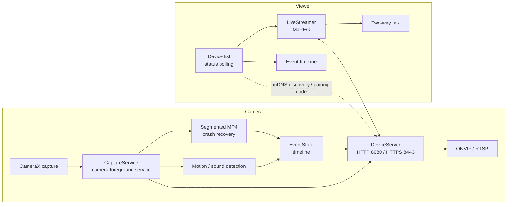
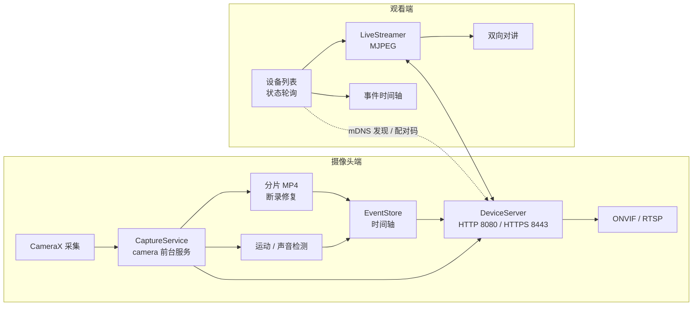

<div align="center">


# QuietSentry · 静哨

**Turn a spare Android phone into a private, local-first security camera.**
<br/>
把一台闲置的 Android 手机，变成一台**私有、本地优先**的值守摄像头。

息屏继续录，数据留在设备里，没有账号，也没有订阅。

[](https://developer.android.com/about/versions/pie)
[](https://kotlinlang.org/)
[](#)
[](LICENSE)
[](#privacy--compliance)
[](#privacy--compliance)


</div>

---

## English

QuietSentry (静哨) turns an old, camera-capable Android phone into a long-running,
**private, local-first** surveillance device. The screen can stay off while recording
continues; all footage stays on the device; there is no account and no subscription.

> This README is bilingual. The full Chinese version is below the English section.

### What is it

The phone you replaced still has a working camera and battery — it is just sitting in a
drawer. QuietSentry gives it a second life as a watch camera:

- **Camera role** — a foreground `camera` service keeps capturing even with the screen
  off; events and video segments are written only to local storage.
- **Viewer role** — discover devices on the same LAN automatically, connect by scanning a
  QR code or entering a pairing code, then watch live, review events, and talk back.
- **No account, no relay, no raw footage to any server.** When remote access is needed,
  it is carried by *your own* Tailscale / WireGuard network.

### Features

| Capability | Description |
| --- | --- |
| Screen-off watch | `camera` foreground service + persistent notification; capture continues after the screen turns off and is always confirmable from the notification shade |
| Continuous recording | Record-only mode for full-coverage scenarios; shares the same segmentation and crash-recovery pipeline with watch mode |
| Black-screen capture | Screen stays black; tap to snap, double-tap to switch lens, long-press to exit |
| Motion / sound detection | On-device frame-diff and loudness detection; events feed a local timeline with confidence and trigger counts |
| On-device person confirm | After a motion trigger, an EfficientDet-Lite0 inference runs locally to upgrade the event to a "person" event; model never leaves the device |
| Event review | Timeline, filters, important marking, recently-deleted, and export-to-gallery |
| LAN viewer | mDNS auto-discovery + manual IP/port pairing; device cards sorted by status |
| Secure pairing | 6-digit pairing code, device fingerprint, one-time recovery code, member cap, revocable tokens |
| Transport encryption | HTTP and HTTPS dual stack, per-device self-signed cert, fingerprint-pinned viewer |
| Third-party integration | ONVIF (WS-UsernameToken + PullPoint event subscription) and RTSP, ready for Frigate / Home Assistant |
| Remote actions | Viewer triggers two-way talk, siren, and flashlight (all auto-ending with a persistent notification) |
| Detection schedule | Alerts only inside set time windows to avoid meaningless night-time disturbance |
| Offline buffering | Events queue locally while offline and flush a digest on reconnect |
| Diagnostics & audit | Health panel, one-tap diagnostic report, and operation audit export |

### Architecture



- One app, two roles: the same package works as both camera and viewer.
- LAN streaming uses HTTP/HTTPS + MJPEG; third-party integration uses ONVIF/RTSP, with no cloud relay.
- Events and clips live in the app's private directory; export is an explicit user action.

### Quick Start

#### Requirements

| Dependency | Version |
| --- | --- |
| JDK | 17 (recommended — Kotlin's compiler may fail to parse versions above 17) |
| Android SDK | Platform 35 (build-tools 34.0.0 works) |
| Gradle | 8.9 (no wrapper is bundled — use a system Gradle) |

Dependency repositories are pre-configured with Aliyun mirrors; the first build needs internet.

#### Build & install

```bat
:: Check deps + bump today's patch number + build debug APK
scripts\构建.bat

:: Build and install to the connected device (prompts when multiple are found)
scripts\构建并推送.bat

:: Push an already-built APK only
scripts\推送.bat -Variant debug
```

> Build / push / release scripts live under `scripts/` and are run from the project root.

The build script writes **today's date + an incrementing index** into `build.patch` of the
root `package.json` and bumps `buildNumber` (the `versionCode`) before every package, so
every artifact has a unique version:

```json
"build": {
  "buildNumber": 20,
  "patch": "20261110.1",
  "builtAt": "2026-11-10 17:18:17"
}
```

> Building directly from Android Studio does not advance the version number; it falls back
> to the baseline version in `package.json`.

#### Publish to GitHub Release

The entry point `scripts\一键发布.bat` chains build → sign → verify → create GitHub Release
(backed by `scripts/release.ps1`, which can also be called directly with arguments):

1. Create a release keystore (do **not** commit the keystore or its config):

   ```bat
   keytool -genkeypair -v -keystore release.jks -alias quiet-sentry ^
     -keyalg RSA -keysize 2048 -validity 10000
   copy keystore.properties.example keystore.properties
   ```

   Fill `storeFile / storePassword / keyAlias / keyPassword` in `keystore.properties`
   (placeholders `<...>` must be replaced with real values, or the script refuses to run).

2. Run the release entry point:

   ```bat
   scripts\一键发布.bat
   ```

   It checks deps → bumps the patch → builds & signs APK and AAB → verifies with
   `apksigner` → creates the GitHub Release and uploads artifacts via the `gh` CLI
   (preferred) or `GITHUB_TOKEN`.

Common switches (passed to `scripts/release.ps1` or `一键发布.bat`):

| Switch | Effect |
| --- | --- |
| `-NoUpload` | Build, sign, and verify only; artifacts stay in `release/`, no Release is created or uploaded |
| `-SkipBuild` | Reuse artifacts already in `release/`; skip build, only re-verify and publish |
| `-Draft` | Create a GitHub Draft Release for further editing before going live |

> Without a GitHub remote (`git remote` has no `github.com`) or without `gh` /
> `GITHUB_TOKEN`, the script keeps local signed artifacts and exits — it never publishes
> halfway. Any failure also preserves already-generated artifacts.

#### Regenerate icons

```bat
python scripts\gen-icons.py
```

Outputs launcher icons at 5 densities, the round icon, the adaptive foreground, the 512px
Play Store icon, and the 1280×640 social preview.

### Project structure

```text
.
├─ app/src/main/java/com/quietsentry/app/   # capture, detection, LAN server, viewer, settings
├─ app/src/main/assets/models/              # EfficientDet-Lite0 person model (4.5 MB)
├─ app/src/main/res/                        # dark design tokens, layouts, icons
├─ assets/brand/                            # logo, Play Store icon, social preview
├─ docs/                                    # UX, tech design, compliance, compat matrix, release checklist
├─ scripts/                                  # build / push / release / icon scripts (unified entry)
├─ tools/verify/                             # ONVIF / RTSP / TLS / stability verification scripts
├─ PRD-QuietSentry.md                       # product requirements document
└─ package.json                             # version & build metadata
```

### Privacy & compliance

- **Data stays on device:** no upload is enabled by default; third-party integration and
  remote access must be explicitly turned on in settings.
- **Capture is always visible:** a persistent foreground notification during watch cannot be
  dismissed — a product constraint and a basic notice to people nearby.
- **Use boundary:** use only where you own the space or have clear authorization. Filming
  others' living spaces without their knowledge is illegal in most regions.
- **Least privilege:** camera, microphone, notification, network; no contacts, location,
  or other unrelated permissions.
- **No "invisible" promise:** some markets force a shutter sound and the system camera
  pipeline may show unavoidable indicators; the product does not try to bypass them.

### Roadmap

- [ ] 8-brand real-device compatibility matrix and a 7-day continuous-stability gate
- [ ] Foldable / multi-window pass and PIN-failure lockout policy review
- [ ] Frigate / Home Assistant live integration testing
- [ ] Two-way audio AEC and noise-reduction field testing

### Documentation

- [Product Requirements Document (Markdown)](PRD-QuietSentry.md)
- [Product Requirements Document (HTML)](PRD-QuietSentry.html)
- `docs/` — interaction specs, technical design, compliance checklist, compatibility
  matrix, and release checklist

### License

Released under the [Apache License 2.0](LICENSE). You may use, reproduce, and distribute it
under the terms of the Apache-2.0. There is no proprietary edition and no paid tier.

---

## 中文

# 静哨 QuietSentry

把一台闲置的 Android 手机，变成一台**私有、本地优先**的值守摄像头。

息屏继续录，数据留在设备里，没有账号，也没有订阅。

### 这是什么

换下来的旧手机，硬件完好、摄像头可用，却往往躺在抽屉里。静哨把它变成一台能长期值守的监控设备：

- **摄像头端**：前台服务持续采集，**熄屏后画面不中断**；事件与分片视频只写本机存储。
- **观看端**：同一局域网内自动发现设备，扫码或配对码连接，实时看画面、回看事件、双向对讲。
- **不建账号、不做中转、不把原始画面交给任何服务器。** 需要公网访问时，由用户自己的 Tailscale / WireGuard 组网承担。

### 功能

| 能力 | 说明 |
| --- | --- |
| 息屏值守 |  `camera` 类型前台服务 + 持续通知；屏幕熄灭后采集继续，通知栏随时可确认 |
| 连续记录 | 只录不检，适合想留下完整时段的场景；与值守共用分片与断录修复管线 |
| 黑屏记录 | 屏幕全黑，单击拍照、双击切镜头、长按退出 |
| 运动 / 声音检测 | 端侧帧差与响度检测，事件进入本地时间轴，支持置信度与触发次数 |
| 端侧人形确认 | 运动触发后追加一次 EfficientDet-Lite0 推理，确认画面中有人才升级为“人形”事件；模型全程本地，不联网 |
| 事件回看 | 时间轴、筛选、重要标记、最近删除、片段导出到相册 |
| 局域网观看端 | mDNS 自动发现 + 手动 IP/端口配对；设备卡片按状态排序 |
| 安全配对 | 6 位配对码、设备指纹、一次性恢复码、授权成员上限，令牌可撤销 |
| 传输加密 | HTTP 与 HTTPS 双栈，自签证书按设备生成，观看端按指纹 pin 校验 |
| 第三方集成 | ONVIF（WS-UsernameToken + PullPoint 事件订阅）与 RTSP，可接入 Frigate / Home Assistant |
| 远程动作 | 观看端触发双向对讲、警笛、手电（均带自动结束与常驻通知） |
| 检测时段 | 只在设定时段内产生告警通知，避免夜间无意义打扰 |
| 离线补记 | 断网期间事件本地排队，恢复后发送摘要 |
| 诊断与审计 | 健康面板、一键导出诊断报告与操作审计 |

### 架构



- 单 App 双角色：同一安装包既可作摄像头端，也可作观看端。
- 局域网流走 HTTP/HTTPS 与 MJPEG；第三方集成走 ONVIF/RTSP，不引入云中转。
- 事件与片段全部落在应用私有目录，导出由用户显式操作。

### 快速开始

#### 环境

| 依赖 | 版本 |
| --- | --- |
| JDK | 17（推荐；高于 17 时 Kotlin 编译器可能无法解析其版本号） |
| Android SDK | Platform 35（build-tools 34.0.0 可用） |
| Gradle | 8.9（项目未内置 wrapper，使用系统 Gradle） |

依赖仓库已配置阿里云镜像，首次构建需要联网。

#### 构建与安装

```bat
:: 检查依赖 + 生成当天 patch 号 + 构建 debug APK
scripts\构建.bat

:: 构建并安装到当前连接的设备（多台时会让你选）
scripts\构建并推送.bat

:: 只推送已构建的 APK
scripts\推送.bat -Variant debug
```

> 构建 / 推送 / 发布脚本统一放在 `scripts/` 下，可直接从项目根执行上面的相对路径命令。

构建脚本会在每次打包前把 **当天日期 + 递增序号** 写入根 `package.json` 的 `build.patch`，
并递增 `buildNumber`（即 `versionCode`），保证每次产物版本唯一：

```json
"build": {
  "buildNumber": 20,
  "patch": "20261110.1",
  "builtAt": "2026-11-10 17:18:17"
}
```

> 直接用 Android Studio 构建不会推进版本号，版本回退为 `package.json` 中的基线版本。

#### 发布到 GitHub Release

发布入口 `scripts\一键发布.bat` 把构建、签名、验签与 GitHub Release 创建串成一步
（底层即 `scripts/release.ps1`，可直接带参调用）：

1. 创建发布密钥（密钥文件与配置都不要提交到仓库）：

   ```bat
   keytool -genkeypair -v -keystore release.jks -alias quiet-sentry ^
     -keyalg RSA -keysize 2048 -validity 10000
   copy keystore.properties.example keystore.properties
   ```

   按提示在 `keystore.properties` 中填写 `storeFile / storePassword / keyAlias / keyPassword`
   （占位符 `<...>` 必须替换为真实值，否则脚本会拒绝执行）。

2. 运行发布入口：

   ```bat
   scripts\一键发布.bat
   ```

   脚本会：检查依赖 → 推进 patch 号 → 构建并签名 APK 与 AAB → `apksigner` 校验签名
   → 通过 `gh` CLI（优先）或 `GITHUB_TOKEN` 在 GitHub 创建 Release 并上传产物。

常用开关（传给 `scripts/release.ps1` 或 `一键发布.bat`）：

| 开关 | 作用 |
| --- | --- |
| `-NoUpload` | 只构建、签名、验签，产物留在 `release/`，**不**创建或上传 Release。适合本地验证与 CI 门禁 |
| `-SkipBuild` | 复用 `release/` 中已有产物，跳过构建，仅重新验签并发布 |
| `-Draft` | 创建为 GitHub Draft Release，正式发布前可再编辑 |

> 没有 GitHub 远端（`git remote` 不含 `github.com`）或没有 `gh` / `GITHUB_TOKEN` 时，
> 脚本只保留本地签名产物并退出，**不会半途发布**；任一步失败也会保留已生成的产物。
> 完整的构建产物目录与 release 链路机制见
> [`docs/09-构建产物与release目录.md`](docs/09-构建产物与release目录.md)。

#### 重新生成图标

```bat
python scripts\gen-icons.py
```

同时输出 5 个密度的启动图标、圆形图标、自适应前景、Play Store 512 图标与 1280×640 社交预览。

### 项目结构

```text
.
├─ app/src/main/java/com/quietsentry/app/   # 采集、检测、局域网服务、观看端、设置
├─ app/src/main/assets/models/              # EfficientDet-Lite0 人形检测模型（4.5 MB）
├─ app/src/main/res/                        # 暗色设计令牌、布局、图标
├─ assets/brand/                            # Logo、Play Store 图标、社交预览
├─ docs/                                    # 交互、技术方案、合规、兼容矩阵、发布清单
├─ scripts/                                  # 构建 / 推送 / 发布 / 图标生成脚本（统一入口）
├─ tools/verify/                             # ONVIF / RTSP / TLS / 稳定性验证脚本
├─ PRD-QuietSentry.md                       # 产品需求文档
└─ package.json                             # 版本与构建元数据
```

### 隐私与合规

- **数据不出设备**：默认不开启任何上传；第三方集成与公网访问都必须由用户在设置中显式开启。
- **采集必然可见**：值守期间常驻前台通知不可关闭，这是产品约束，也是对周围人的基本告知。
- **使用边界**：请只在自己拥有或已获得明确授权的场所使用。在他人不知情的情况下拍摄其生活空间，在多数地区违法。
- **权限最小化**：相机、麦克风、通知、网络；不申请通讯录、位置等无关权限。
- **不承诺“无痕”**：部分市场强制快门音，系统相机管线也可能有不可屏蔽的指示，产品不会为此做规避。

### Roadmap

- [ ] 8 品牌真机兼容矩阵与 7 天连续稳定性门禁
- [ ] 折叠屏 / 多窗口专项与 PIN 失败锁定策略复核
- [ ] Frigate / Home Assistant 实机联调
- [ ] 双向语音 AEC 与降噪实测

### 文档

- [产品需求文档（Markdown）](PRD-QuietSentry.md)
- [产品需求文档（HTML）](PRD-QuietSentry.html)
- `docs/` 下的交互说明、技术方案、合规清单、兼容矩阵与发布清单

### 许可证

本项目以 [Apache License 2.0](LICENSE) 发布（[`LICENSE`](LICENSE)）。
你可以根据 Apache-2.0 的条款使用、复制和分发它。没有专有版本，也没有付费档位。
