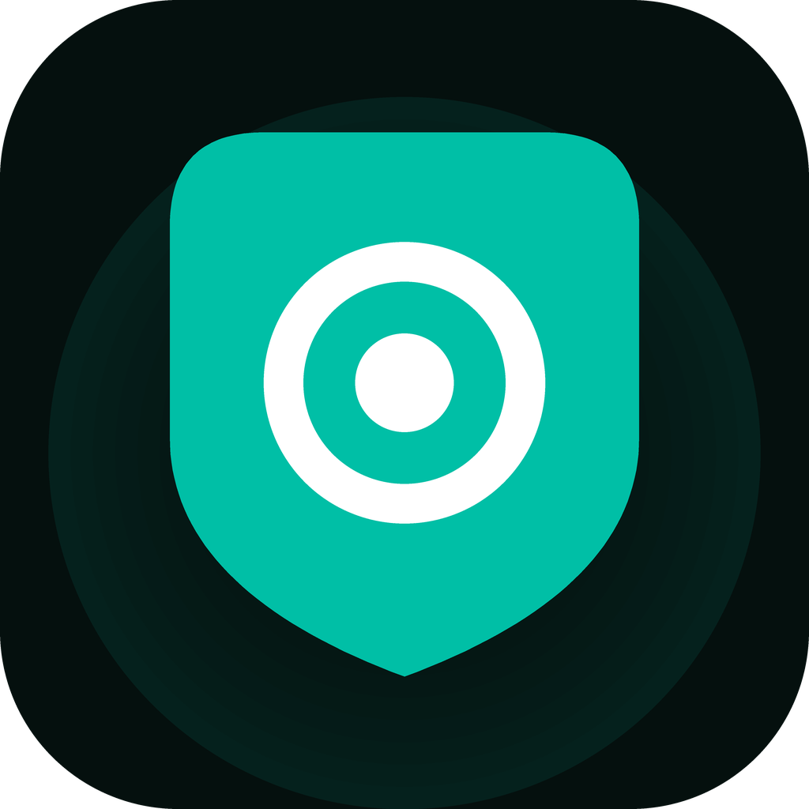
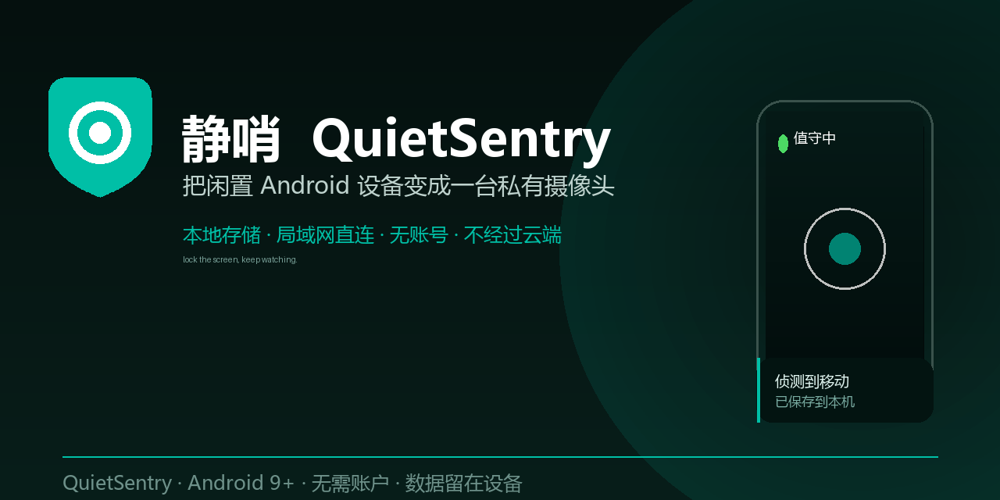
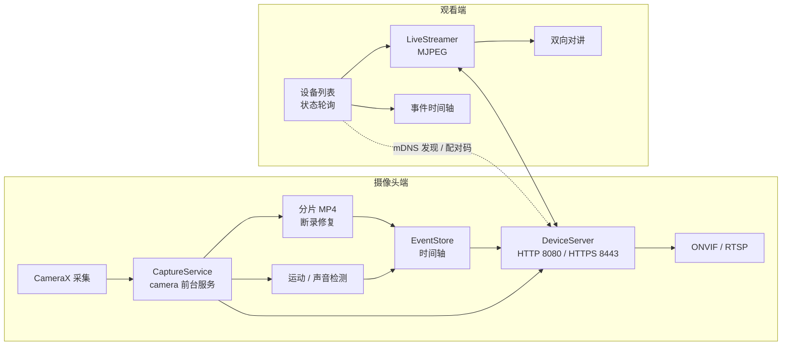

<div align="center">



# 静哨 QuietSentry

把一台闲置的 Android 手机，变成一台**私有、本地优先**的值守摄像头。

息屏继续录，数据留在设备里，没有账号，也没有订阅。

[](https://developer.android.com/about/versions/pie)
[](https://kotlinlang.org/)
[](#)
[](#隐私与合规)
[](#隐私与合规)



</div>

---

## 这是什么

换下来的旧手机，硬件完好、摄像头可用，却往往躺在抽屉里。静哨把它变成一台能长期值守的监控设备：

- **摄像头端**：前台服务持续采集，**熄屏后画面不中断**；事件与分片视频只写本机存储。
- **观看端**：同一局域网内自动发现设备，扫码或配对码连接，实时看画面、回看事件、双向对讲。
- **不建账号、不做中转、不把原始画面交给任何服务器。** 需要公网访问时，由用户自己的 Tailscale / WireGuard 组网承担。

## 功能

| 能力 | 说明 |
| --- | --- |
| 息屏值守 |  `camera` 类型前台服务 + 持续通知；屏幕熄灭后采集继续，通知栏随时可确认 |
| 连续记录 | 只录不检，适合想留下完整时段的场景；与值守共用分片与断录修复管线 |
| 黑屏记录 | 屏幕全黑，单击拍照、双击切镜头、长按退出 |
| 运动 / 声音检测 | 端侧帧差与响度检测，事件进入本地时间轴，支持置信度与触发次数 |
| 事件回看 | 时间轴、筛选、重要标记、最近删除、片段导出到相册 |
| 局域网观看端 | mDNS 自动发现 + 手动 IP/端口配对；设备卡片按状态排序 |
| 安全配对 | 6 位配对码、设备指纹、一次性恢复码、授权成员上限，令牌可撤销 |
| 传输加密 | HTTP 与 HTTPS 双栈，自签证书按设备生成，观看端按指纹 pin 校验 |
| 第三方集成 | ONVIF（WS-UsernameToken + PullPoint 事件订阅）与 RTSP，可接入 Frigate / Home Assistant |
| 远程动作 | 观看端触发双向对讲、警笛、手电（均带自动结束与常驻通知） |
| 检测时段 | 只在设定时段内产生告警通知，避免夜间无意义打扰 |
| 离线补记 | 断网期间事件本地排队，恢复后发送摘要 |
| 诊断与审计 | 健康面板、一键导出诊断报告与操作审计 |

## 架构



- 单 App 双角色：同一安装包既可作摄像头端，也可作观看端。
- 局域网流走 HTTP/HTTPS 与 MJPEG；第三方集成走 ONVIF/RTSP，不引入云中转。
- 事件与片段全部落在应用私有目录，导出由用户显式操作。

## 快速开始

### 环境

| 依赖 | 版本 |
| --- | --- |
| JDK | 17 |
| Android SDK | Platform 35（build-tools 34.0.0 可用） |
| Gradle | 8.9（项目未内置 wrapper） |

依赖仓库已配置阿里云镜像，首次构建需要联网。

### 构建与安装

```bat
:: 检查依赖 + 生成当天 patch 号 + 构建 debug APK
build.bat

:: 构建并安装到当前连接的设备（多台时会让你选）
build-and-push.bat

:: 只推送已构建的 APK
push.bat -Variant debug
```

构建脚本会在每次打包前把 **当天日期 + 递增序号** 写入根 `package.json` 的 `build.patch`，
并递增 `buildNumber`（即 `versionCode`），保证每次产物版本唯一：

```json
"build": {
  "buildNumber": 12,
  "patch": "20261101.3",
  "builtAt": "2026-11-01 22:55:05"
}
```

> 直接用 Android Studio 构建不会推进版本号，版本回退为 `package.json` 中的基线版本。

### 发布

1. 创建发布密钥（不要提交到仓库）：

   ```bat
   keytool -genkeypair -v -keystore release.jks -alias quiet-sentry ^
     -keyalg RSA -keysize 2048 -validity 10000
   copy keystore.properties.example keystore.properties
   ```

2. 填写 `keystore.properties`，然后运行：

   ```bat
   一键发布.bat
   ```

   脚本会：推进 patch → 构建签名 APK 与 AAB → `apksigner` 校验 → 通过 `gh` 或
   `GITHUB_TOKEN` 创建 GitHub Release 并上传产物。没有远端或凭据时只保留本地产物，不会半途发布。

### 重新生成图标

```bat
python tools\gen-icons.py
```

同时输出 5 个密度的启动图标、圆形图标、自适应前景、Play Store 512 图标与 1280×640 社交预览。

## 项目结构

```text
.
├─ app/src/main/java/com/quietsentry/app/   # 采集、检测、局域网服务、观看端、设置
├─ app/src/main/res/                        # 暗色设计令牌、布局、图标
├─ assets/brand/                            # Logo、Play Store 图标、社交预览
├─ docs/                                    # 交互、技术方案、合规、兼容矩阵、发布清单
├─ tools/                                   # 构建 / 推送 / 发布 / 图标生成脚本
├─ PRD-QuietSentry.md                       # 产品需求文档
├─ build.bat  push.bat  build-and-push.bat  一键发布.bat
└─ package.json                             # 版本与构建元数据
```

## 隐私与合规

- **数据不出设备**：默认不开启任何上传；第三方集成与公网访问都必须由用户在设置中显式开启。
- **采集必然可见**：值守期间常驻前台通知不可关闭，这是产品约束，也是对周围人的基本告知。
- **使用边界**：请只在自己拥有或已获得明确授权的场所使用。在他人不知情的情况下拍摄其生活空间，在多数地区违法。
- **权限最小化**：相机、麦克风、通知、网络；不申请通讯录、位置等无关权限。
- **不承诺“无痕”**：部分市场强制快门音，系统相机管线也可能有不可屏蔽的指示，产品不会为此做规避。

## Roadmap

- [ ] 端侧人形检测模型（P1，需引入 TFLite 与模型资产）
- [ ] 8 品牌真机兼容矩阵与 7 天连续稳定性门禁
- [ ] 折叠屏 / 多窗口专项与 PIN 失败锁定策略复核
- [ ] Frigate / Home Assistant 实机联调
- [ ] 双向语音 AEC 与降噪实测

## 文档

- [产品需求文档（Markdown）](PRD-QuietSentry.md)
- [产品需求文档（HTML）](PRD-QuietSentry.html)
- `docs/` 下的交互说明、技术方案、合规清单、兼容矩阵与发布清单

## 许可证

项目尚未附加开源许可证文件。在选定协议前，请勿默认其可被任意分发或商用。
